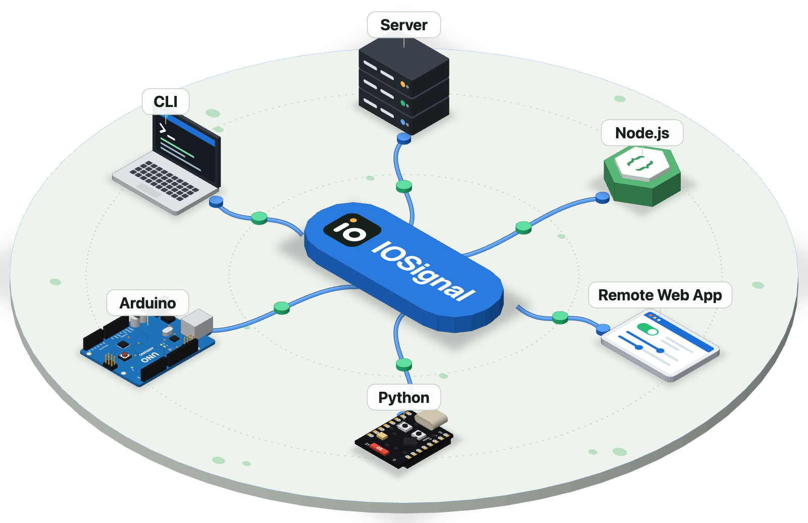

# iosignal

[English](https://github.com/remocons/iosignal/blob/main/README.md) | [한국어](https://github.com/remocons/iosignal/blob/main/README.ko.md)

A real-time messaging library for Node.js and browsers, providing WebSocket
client–server communication, tag-based publish/subscribe and RPC services.
Node.js also supports TCP through `IOCongSocket`.

<p align="center">
  
</p>

## Documentation and supported environments

The [official documentation](https://iosignal.net/) covers installation, messaging
concepts and platform guides in Korean. Follow the
[five-minute quick start](https://iosignal.net/docs/start/quickstart/) for an overview,
and use the quick start below for examples targeting the current version.

| Environment / tool | Support | Package / examples |
| --- | --- | --- |
| Node.js | WebSocket/TCP servers and clients, publish/subscribe, RPC | This repository · [npm](https://www.npmjs.com/package/iosignal) |
| Browsers | WebSocket clients and web app integration | `iosignal/io` · [examples](https://github.com/remocons/iosignal-examples) |
| Arduino | Device communication with servers and web apps, authentication and encryption | [iosignal-arduino](https://github.com/remocons/iosignal-arduino) |
| CLI | Run servers and clients and test messaging in a terminal | [iosignal-cli](https://github.com/remocons/iosignal-cli) |

Try messaging in the [browser communication workbench](https://test.iosignal.net/).

## Installation

```bash
npm install iosignal
```

The Node.js examples below use ESM. Save them as `.mjs` files or set
`"type": "module"` in your project's `package.json`.

## Quick start

### Server

Save the following as `server.mjs` and run `node server.mjs`.

```js
import { Server, replyService } from 'iosignal';

const server = new Server({ port: 8080 });
server.attach('reply', replyService);

server.on('ready', () => {
  console.log(`Listening on port ${server.port}`);
});

process.once('SIGINT', () => server.close());
```

This is a local development server without authentication.

### Node.js client

After starting the server, save the following as `client.mjs` and run
`node client.mjs`.

```js
import { IO } from 'iosignal';

const io = new IO('ws://localhost:8080');
io.on('error', console.error);

io.on('ready', async () => {
  try {
    const response = await io.call('reply', 'echo', 'Hello, iosignal!');
    console.log(response.body);
  } catch (error) {
    console.error(error);
  } finally {
    io.stop();
  }
});
```

The public API is also available from CommonJS.

```js
const { IO, Server, replyService } = require('iosignal');
```

## Publish and subscribe

Once connected, use `subscribe()` to subscribe to a tag and `signal()` to send
messages. The following client keeps receiving messages.

```js
import { IO } from 'iosignal';

const io = new IO('ws://localhost:8080');
io.on('error', console.error);
io.on('message', (tag, message) => {
  console.log(tag, message);
});
io.on('ready', () => {
  io.subscribe('room');
  io.signal('room', 'Hello, subscribers!');
});

process.once('SIGINT', () => io.stop());
```

`signal(tag, ...args)` supports strings, binary data, objects and multiple
arguments. Use `unsubscribe(tag)` to unsubscribe.

See the [messaging guide](https://github.com/remocons/iosignal/blob/main/docs/messaging.md) for tag rules and direct-message handling.

## Browsers

For browser projects using a bundler, import the browser-specific entry point.

```js
import IO from 'iosignal/io';

const io = new IO('ws://localhost:8080');
io.on('error', console.error);
io.on('message', (tag, message) => console.log(tag, message));
io.on('ready', () => {
  io.subscribe('room');
  io.signal('room', 'Hello from the browser!');
});
```

This browser example connects to the same server above. From an HTTPS page,
use a `wss://` server URL with TLS configured. When finished, call `io.stop()`
to close the connection and stop automatic reconnection.

## Arduino support

[iosignal-arduino](https://github.com/remocons/iosignal-arduino) provides an Arduino
client and examples for boards including ESP32 and ESP8266. Install the library
and its Boho and Crypto dependencies, then configure the network and server in
an example for your board. See the [official Arduino guide](https://iosignal.net/docs/arduino)
and [library README](https://github.com/remocons/iosignal-arduino/blob/main/README.en.md)
for setup and connection instructions.

## CLI support

[iosignal-cli](https://github.com/remocons/iosignal-cli) runs a server or an
interactive client without writing application code. Requires Node.js 22.16.0 or later.

```bash
npm install -g iosignal-cli
io-server -l 8080
```

Connect from another terminal. If the JavaScript server above is already running,
run only the client:

```bash
io-client -c ws://localhost:8080
```

Enter `help`, `sub room` and `pub room hello` in the client to explore messaging.
To also test Arduino over TCP, start the server with
`io-server -l 8080 -L 8888` and connect the device to TCP port 8888.
See the [CLI README](https://github.com/remocons/iosignal-cli/blob/main/README.en.md)
for more options.

## Main APIs

| API | Purpose |
| --- | --- |
| `Server` | Create a WebSocket/TCP server |
| `IO` | Node.js WebSocket client; the browser client when imported from `iosignal/io` |
| `IOCongSocket` | Node.js TCP client |
| `server.attach(name, service)` | Register an RPC service |
| `io.call(service, command, ...args)` | Make an RPC request |
| `io.subscribe(tag)` / `io.unsubscribe(tag)` | Subscribe / unsubscribe |
| `io.signal(tag, ...args)` | Publish or send a direct message |
| `io.on(tag, handler)` | Register an event handler |
| `io.listen(tag, handler)` | Register a handler; remember subscriptions for non-direct tags |
| `io.ping()` | Ping the server; receive the protocol `pong` event |
| `io.stop()` | Stop automatic reconnection and clean up the connection |
| `server.close(callback)` | Shut down the server |
| `BohoAuth` | Server authentication manager |
| `StringKeyProvider`, `FileKeyProvider`, `RedisKeyProvider` | Authentication key providers |
| `LocalKeyProvider` | Key-list-free logins for local tests (`localAuth` server option) |
| `ROLES`, `hasRole(remote, role)` | Connection roles for service permission checks |
| `server.stats()` | Connection, channel, retain and traffic counters |

## Authentication and encryption

[Boho](https://github.com/remocons/boho) provides shared-key authentication and
message encryption for JavaScript and Arduino. End-to-end encryption (E2E) uses
a separate data key shared only by the final endpoints. See the
[Boho technical guide](https://github.com/remocons/iosignal/blob/main/docs/boho.md) for key management, the relationship
with TLS, session validation and implementation conditions.

For local tests, the `localAuth` server option turns on authentication without
a key list. The login ID becomes the CID. Anyone who knows the rule can log in
under any ID, so use it only on a trusted local network. Added in 8.1.0.

```js
new Server({ port: 7777, localAuth: 'idKey' })                                // io.auth('dev1', 'dev1')
new Server({ port: 7777, localAuth: { mode: 'sharedKey', key: 'lab2026' } })  // io.auth('dev1', 'lab2026')
```

Add `membersOnly: true` to close anonymous connections that send a signal or
subscribe. See
[Local test logins](https://github.com/remocons/iosignal/blob/main/docs/boho.md#local-test-logins-localauth).

## Roles and quotas

A connection's **role** decides what it may do; its **quota profile** decides
how much it may send. They are independent.

- Roles, lowest first: `anonymous` (not logged in), `device` (default for a
  login), `service`, `admin`. A key entry gives the role:
  `id.key.cid[.role[.quota]]`, e.g. `'dev1.k1.dev1'` or `'cli.k2.cli.admin'`.
  Services check it with `hasRole(remote, 'admin')`; `sudoService` needs
  `admin`, `RedisService(client, minRole)` defaults to `service`.
- Quota profiles are named sets of limits in the `quotas` server option:
  `maxMessageBytes`, `fanout` (subscribers one publish reaches), `msgPerSec`,
  `bytesPerSec`, `maxConnections` per account and `maxSubscriptions` (tags one
  connection may be subscribed to). `null` means unlimited.
  The server always enforces them. Unauthenticated connections use
  `anonymousQuota`; a login uses its key entry's quota, or the result of the
  `BohoAuth` `resolveQuota(authInfo, role)` option.
- The built-in profiles (`anonymous`, `basic`, `pro`, `unlimited` in
  `serverOption.quotas`) are starting points for the operator to tune, not
  values to rely on. Clients read `io.quota.maxMessageBytes` after `ready`.

```js
const server = new Server({
  port: 7777,
  quotas: { anonymous: { maxMessageBytes: 64 * 1024 }, basic: { fanout: 200 } },
  anonymousQuota: 'anonymous'
}, new BohoAuth(new StringKeyProvider('dev1.k1.dev1,cli.k2.cli.admin')));
```

## Upgrading from 8.x

9.0 removes the quota level table and changes settings without a
compatibility layer. Old setting names throw an error that names the
replacement.

- Key entries use roles and quota names instead of levels:
  `id.key.cid.255` becomes `id.key.cid.admin`, `id.key.cid.3` becomes
  `id.key.cid`. `addAuth(id, key, cid, role, quota)` and file entries
  `[id, key, cid, role, quota]` follow the same order. A level is no longer read.
- Removed: `quotaTable`, `serverOption.useQuota`, `defaultQuotaIndex`,
  `adminLevel`, `remote.level`, `io.level`, the `QUOTA_LEVEL` message, and
  `RedisService`'s `minLevel`/`requireAuth` arguments.
- Every setting is per server and `serverOption` only holds defaults that a
  Server never changes. Renamed: `timeout` → `heartbeatInterval`,
  `pingTimeoutGrace` → `heartbeatGrace`, `retain.isAvailable` →
  `retain.enabled`, `auth.delay_auth_fail` → `auth.failDelay`. Removed
  `showMessage`, `showMetric` and `monitorPeriod`; use `logMessages`,
  `logStats` and `server.stats()`.
- New server options: `maxPayload`, `maxBufferedBytes`, `trustProxy`,
  per-server `membersOnly` and `duplicateLogin`, and retained-message budgets
  per owner in `retain`.
- The quota is sent in a new `QUOTA` message; older clients ignore it and
  keep their previous local size limit.

## Changes in 9.23

- Device rules: `iosignal/devices` holds the rules devices and apps share
  (`$name`, `$ui`, `$state`, screens, pictures), web components for a device
  panel (`<iosignal-devices>`) and a single card
  (`<iosignal-device-card cid>`), a virtual device runner, the official device
  types and example devices, as plain ES modules and JSON. `registerWidget`,
  `registerView` and `registerType` add an application's own; other apps fall
  back to the device's buttons.
- Health check: a server with `port` answers `GET /healthz` with
  `{"status":"ok"}` (503 while closing). `healthPath` changes the path, `false`
  turns it off. With your own `httpServer`, call `server.handle(req, res)`,
  which also serves the dashboard.
- Dashboard: `links` and `cidHref` options, `dashboard.panel(id, { title,
  columns, rows })` for an application's own table, device names in the
  participant table, and a warning when an `open` dashboard is viewed from a
  public address.
- Client: `io.pingServer({ timeoutMs })` resolves with the round trip to the
  server in milliseconds.
- `bufferutil` and `utf-8-validate` are no longer optional dependencies. `ws`
  still uses them when your project installs them.
- A failed listen on the server's own HTTP port is reported once (was twice).

## Changes in 9.22

- Browser client: `IO.WebSocket` sets the class to connect with (anything with
  the browser WebSocket API; `null`, the default, uses the global `WebSocket`),
  and a subclass can override `createWebSocket(url)` to choose it by URL.
- The server parses CongSocket (TCP) frames without Node.js streams
  (`CongParser`); `CongRx` keeps its stream API.

## Changes in 9.21

- `membersOnly` also closes an anonymous connection that subscribes (before,
  only one that sent a signal).
- Quota `maxSubscriptions`: tags over it are not subscribed
  (`SUBSCRIBE_REQ` answers 255).
- Wrong logins: a connection is closed after 5; a public address with 30 in a
  minute has its next logins closed without a check until the minute has
  passed (`serverOption.auth`). A key store that cannot be read closes the
  connection instead of answering `AUTH_FAIL`, so the client logs in again.
- Key providers refuse a login ID longer than 8 bytes when it is added (it was
  cut to 8 bytes and could not match).
- `security.requireEncryption` (off by default): a logged-in connection without
  TLS may not send plain signals, subscriptions or calls.
- Client: after 40 s without anything from the server it sends a PING, and
  closes the connection when nothing arrives within 15 s (then reconnects).
  Reconnect attempts start after up to 1 s and, while none reaches `ready`,
  wait 3, 6, 12, 24 and then 30 s instead of always 3 s.
- Client: a signal on a channel named like one of the client's own events
  (`close`, `ready`, `error`, `change`, ...) is emitted as `message` only.

## Detailed guides

- [Signal tags and direct messages](https://github.com/remocons/iosignal/blob/main/docs/messaging.md)
- [Server ping](https://github.com/remocons/iosignal/blob/main/docs/ping.md)
- [Boho authentication, encryption and E2E](https://github.com/remocons/iosignal/blob/main/docs/boho.md)
- [Building and verification](https://github.com/remocons/iosignal/blob/main/docs/development.md)

## License

Package license: MIT.
